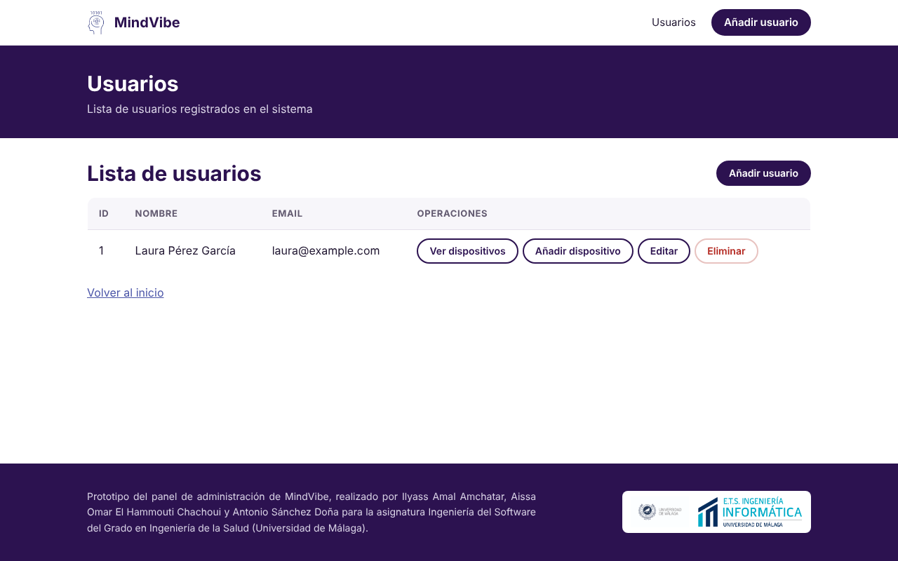

# MindVibe: casco EEG que adapta la música a tu estado emocional

**Escucha lo que sientes, transforma lo que piensas.**

MindVibe es el concepto de un producto que combina un casco con sensores de electroencefalografía (EEG) con una aplicación de música: el sistema interpreta la actividad cerebral del usuario, estima su estado emocional con un modelo de inteligencia artificial y adapta en tiempo real la música que escucha para ayudarle a relajarse, concentrarse o gestionar el estrés.

*Concept project for an EEG headset that adapts music to the user's emotional state, developed through the full software engineering lifecycle, with a Spring Boot prototype of the admin panel.*

**Web del proyecto:** [antoniodoa9.github.io/mindvibe](https://antoniodoa9.github.io/mindvibe/), con una [demostración del panel de administración](https://antoniodoa9.github.io/mindvibe/panel.html) que funciona directamente en el navegador.

Lo hemos desarrollado en la asignatura **Ingeniería del Software** del Grado en Ingeniería de la Salud (Universidad de Málaga), entre octubre y diciembre de 2024.

## Qué incluye el proyecto

Hemos seguido el ciclo completo de Ingeniería del Software, en varias prácticas encadenadas:

| Fase | Qué hemos hecho |
|---|---|
| Entrevista | Entrevista con el cliente para entender el problema y sus necesidades |
| Plan de proyecto | Oportunidad de negocio, participantes y usuarios, alcance, riesgos y planificación con diagrama de Gantt |
| Requisitos | 13 requisitos funcionales de usuario, requisitos no funcionales y su traducción a requisitos del sistema, con una *Definition of Done* |
| Modelado con UML | Diagramas de clases, casos de uso, máquina de estados y secuencia |
| Diseño | Revisión del diagrama de clases aplicando patrones de diseño |
| Desarrollo | Prototipo funcional del panel de administración (requisito RF10) |

Toda la documentación final está en [`documentacion/Plan de proyecto MindVibe v4.0.pdf`](documentacion).

## El prototipo

El prototipo es el panel que usaría el administrador del sistema para gestionar los usuarios de MindVibe y los cascos asociados a cada uno. Permite listar, añadir, editar y eliminar usuarios, y para cada usuario ver, añadir, editar y eliminar sus dispositivos (modelo y batería). Al borrar un usuario se borran también sus dispositivos.

Está hecho con **Java, Spring Boot 3, Thymeleaf, Spring Data JPA y una base de datos H2** guardada en un fichero. El modelo tiene dos entidades, `Usuario` y `Dispositivo`, con una relación de uno a muchos.

Sobre la versión entregada en la asignatura hemos mejorado el aspecto de la web: todas las páginas comparten ahora una cabecera, un pie y una hoja de estilos (`static/css/mindvibe.css`), los formularios y tablas tienen un diseño más claro, se pide confirmación antes de borrar y hemos añadido la página `error.html`, que los controladores ya usaban pero no existía.

### Cómo ejecutarlo

1. Instalar un JDK 18 o superior y Maven.
2. Desde la carpeta `app`, ejecutar `mvn spring-boot:run`.
3. Abrir [http://localhost:8080](http://localhost:8080) en el navegador.

Hemos comprobado que el proyecto compila y arranca con Java 21 y que todas las pantallas funcionan: alta, edición y borrado de usuarios y de sus dispositivos, y la página de error.



La consola de la base de datos H2 está en [http://localhost:8080/h2](http://localhost:8080/h2), con la URL JDBC `jdbc:h2:file:./database` y el usuario `sa` sin contraseña (es una base de datos local de prueba).

## Estructura del repositorio

```
app/                          prototipo en Spring Boot
  src/main/java/.../controller    controladores de usuarios y dispositivos
  src/main/java/.../model         entidades, repositorios y servicios
  src/main/resources/templates    vistas de Thymeleaf
  src/main/resources/static       hoja de estilos, logos e imágenes
documentacion/
  Plan de proyecto MindVibe v4.0.pdf   documento final del proyecto
  DiagramaGantt_MindVibe.gan           planificación (GanttProject)
  uml/                                 diagramas UML (Visual Paradigm)
docs/                         web del proyecto (GitHub Pages)
  index.html                  presentación del producto
  panel.html                  demostración del panel en el navegador
```

## Equipo

- Antonio Sánchez Doña
- Aissa Omar El Hammouti Chachoui
- Ilyass Amal Amchatar

MindVibe es un proyecto académico (un concepto de producto), no un producto comercial ni un dispositivo médico.
